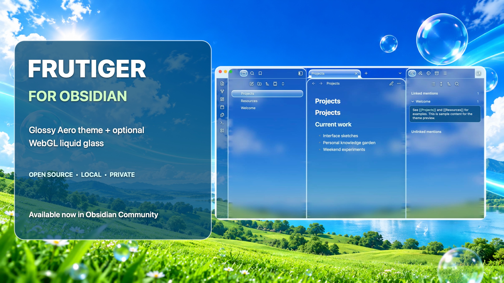

# Frutiger Liquid Glass

A desktop companion for the Frutiger Obsidian theme. It renders a local blue-sky landscape through WebGL2 glass surfaces behind Obsidian's native text and controls.

[Install Frutiger Liquid Glass](https://community.obsidian.md/plugins/frutiger-liquid-glass) · [Install the Frutiger theme](https://community.obsidian.md/themes/frutiger)

## Status

Version 0.1.1 is available through Obsidian Community and GitHub. Version 0.2.0 is in local testing. The screenshot uses sample notes only.

## Use

Install **Frutiger Liquid Glass** from Settings → Community plugins. Enable it and select the Frutiger theme in Settings → Appearance. In the plugin settings, you can enable or disable the shader and adjust refraction strength, glass edge thickness, color dispersion, and reflection brightness. The command palette also has **Frutiger Liquid Glass: Toggle shader glass**.

With the **Style Settings** plugin installed, choose a Frutiger wallpaper or the DORFic style under Settings → Style Settings. Liquid Glass detects the theme's shared body classes and redraws its WebGL backdrop automatically. Aero Landscape uses the bundled image; Aqua Current, Glass Bubbles, and DORFic Daylight are generated locally.

For local testing, copy `main.js`, `manifest.json`, and `styles.css` into `<vault>/.obsidian/plugins/frutiger-liquid-glass/`, then enable it in Community plugins.

The effect requires desktop Obsidian with WebGL2. It is limited to the main workspace; pop-out windows use the theme's CSS appearance. If WebGL2 is unavailable or its context is lost, the canvas is removed and the theme's CSS fallback remains. The renderer stops drawing while idle or hidden and caps its canvas at 1920 × 1400 pixels.

## Privacy and source

The plugin uses a bundled landscape image. It does not capture the desktop or note pixels, read or write notes, or make network requests. It saves only its own effect settings through Obsidian's plugin data API.

The WebGL shader is adapted from [Liquid Glass Studio](https://github.com/iyinchao/liquid-glass-studio) by Charles Yin (MIT). See [NOTICE.md](NOTICE.md) and [LICENSE](LICENSE). The Obsidian lifecycle, multi-surface geometry, wallpaper treatment, and CSS integration were added for this plugin.

The committed `main.js` is reproducible from `main.template.js`, `shaders/`, and `aero-landscape.jpg` with `npm run build`. No package installation is needed to build it. `npm run check` verifies JavaScript syntax.

## Release checklist

- [x] Test with Frutiger in a clean vault, including enable, settings, disable, and fallback.
- [x] Capture a screenshot using only sample notes.
- [x] Publish the source in a public GitHub repository.
- [x] Create release `0.1.1` and attach `main.js`, `manifest.json`, and `styles.css` as individual assets.
- [x] Publish through [Obsidian Community](https://community.obsidian.md/plugins/frutiger-liquid-glass).
- [ ] Release and test version `0.2.0` with synchronized wallpaper presets.
